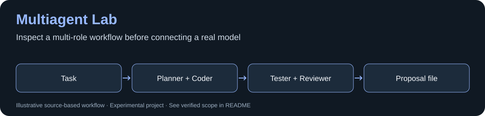

# Multiagent Lab


*Diagrama baseado no código; não representa uma captura da interface nem comprova execução de modelo.*


Protótipo de orquestração de agentes com supervisor e acesso a arquivos limitado a um workspace. Não é uma plataforma de agentes pronta para produção.

## Instalação inicial / First run

No Windows, com Python 3.11+ instalado, clone o projeto e prepare um ambiente isolado:

```powershell
git clone https://github.com/Michaliszyn01/multiagent-lab.git
cd multiagent-lab
py -3 -m venv .venv
```

O modo **fake** usa a biblioteca padrão e não precisa de chave, Ollama ou dependências de API:

```powershell
.\.venv\Scripts\python.exe main.py
```

Escolha `fake` no primeiro campo e informe uma tarefa curta. O arquivo `workspace/generated_proposal.md` contém a proposta; `logs/session_log.txt` contém o registro local. O papel Tester **sugere testes em texto**: não executa os testes da aplicação proposta. O modo fake tem respostas fixas e não demonstra inteligência ou qualidade de um modelo.

Veja a [demonstração reproduzida](docs/DEMO.md). Para Ollama/OpenAI, `requests` é uma dependência opcional; revise configuração e custos antes de mudar de provedor.

## Executar sem custo de API

Python 3.11+. Execute `python main.py` e escolha **fake** quando o modo for solicitado. Escreva uma tarefa pequena. O modo fake não chama modelos externos.

Ollama é opcional. O provedor OpenAI é opcional e pode consumir créditos quando configurado e escolhido; a publicação não executa esse modo. Credenciais ficam em variáveis de ambiente, nunca no código.

## Limites

Faltam testes de integração de provedores, cancelamento, orçamento e revisão da política de escrita para uso com dados reais. O workspace contém somente arquivos de demonstração criados pelo usuário após executar.

## English

An experimental multi-agent supervisor with file access scoped to a workspace. Start with `python main.py` and select `fake` for a no-API demo. Real providers are optional; this prototype is not production-ready.
